# SoundClud — Project Brief & Technical Architecture Specification (v1.1)

> [!IMPORTANT]
> **Universal Portability Mandate (Zero Per-Track / Per-User / Per-Machine Patches)**:
> Every subsystem in `SoundClud` is designed from first principles to work out-of-the-box on a fresh installation for **any user**, with **any SoundCloud account** (unauthenticated, Free, or Go+ `256 kbps` HQ), over **Wi-Fi or Ethernet LANs**, across macOS (Intel macOS 12 Monterey+ and Apple Silicon) and Linux receivers and any **Chromium** desktop browser (`Chrome`, `Brave`, `Arc`, `Edge`). Zero static IPs, personal paths, numeric audio device indices, or track-specific workarounds are permitted.

---

## 1. Locked Architectural Decisions (v1.1)

1. **Default TOSLINK Output Mode — True Bit-Perfect `0 dB` @ Physical `44,100 Hz`**:
   - Receiver digital output defaults strictly to **Bit-Perfect `0 dB` Unity Gain** (`volume=100`, `ao-volume=100`, zero DSP, zero active-playback dither) so volume attenuation occurs exclusively in the external Hi-Fi amplifier (with an opt-in `software_24bit` fallback toggle available in settings for non-amp outputs).
   - Byte-level inspection of SoundCloud `init.mp4` (`esds` ISO 14496-3 `AudioSpecificConfig`) confirms `99.99%` of SoundCloud streams (`aac_256k` Go+ HQ, `aac_160k` SQ, `aac_96k`, `mp3_1_0`) are native **`44,100 Hz`**. On macOS CoreAudio, `soundclud-receiver` locks physical S/PDIF hardware clocking to **`24-bit / 44,100 Hz`** via `--audio-samplerate=44100 --coreaudio-change-physical-format=yes` so `44.1 kHz` Go+ HQ tracks pass through CoreAudio with **zero sample-rate conversion (`1:1` sample frames)**.
2. **Client Browser Target — Chromium Manifest V3 Exclusively**:
   - Targets Chromium (`Google Chrome`, `Brave`, `Arc`, `Edge`, `minimum_chrome_version: "116"`) with zero cross-browser polyfill shims and **zero `"cookies"` permission** in `manifest.json`.
3. **Wi-Fi First-Class Operation & Zero-Click TOFU Security**:
   - **Zero Wi-Fi Audio Glitches**: Because stream fetching and decoding run locally on the receiver (with a `32 MiB` RAM segment cache and `--cache-pause-initial=no`), **zero audio packets cross Wi-Fi between laptop and receiver**—only ~150-byte JSON control/state frames. Closing the laptop lid or experiencing Wi-Fi airtime spikes never interrupts audio.
   - **Wi-Fi Multicast Resilience**: After initial Bonjour/mDNS discovery, reconnects race `hostname.local` against the cached unicast LAN IP (`Promise.any`) over TCP, bypassing 802.11 multicast packet loss (with explicit diagnostics if router Guest/AP Client Isolation is enabled).
   - **Wi-Fi Security**: Uses **zero-click Trust-On-First-Use (TOFU)** cryptographic bearer token pairing + strict `Host` & `Origin` (`chrome-extension://<id>`) verification to block DNS-rebinding and Cross-Site WebSocket Hijacking on Wi-Fi, plus an optional `--require-pin` mode for shared networks.
4. **Always-Default SoundCloud Go+ High Quality (`aac_256k`) With Zero Separate Login**:
   - Piggybacks 100% natively on the user's existing `https://soundcloud.com` login session—no separate OAuth flow or credential entry in SoundClud.
   - Bypasses SoundCloud Web's client-side `"sq"` default (`localStorage["V2::local::settings"].streamingQuality === null`) to select **`aac_256k` (`quality: "hq"`, 256 kbps AAC-LC @ 44.1 kHz)** automatically whenever Go+ is present.

---

## 2. First-Principles Rejection of Naive Approaches

| Flawed Naive Assumption | Why It Fails in Reality | SoundClud First-Principles Architecture |
| :--- | :--- | :--- |
| **1. Backend `yt-dlp` stream extraction** | Spawns Python + scrapes SoundCloud JS bundles (`1,500–3,500 ms` cold start per click), fails on Go+ / private tracks without fragile cookie exports, and breaks whenever SoundCloud rotates `client_id`. | **Browser Stream-Locator Handoff**: The authenticated browser tab already holds `api-v2` `media.transcodings[]`, `track_authorization`, and `OAuth` session context—forwarding the stream locator in `<5 ms` with zero Python/`yt-dlp` dependency. |
| **2. Passing raw SoundCloud `.m3u8` URLs directly to `mpv`** | SoundCloud HLS playlists are VOD (`#EXT-X-ENDLIST`) whose CloudFront `#EXT-X-MAP` (`init.mp4`), `#EXT-X-KEY`, and segment URLs expire after **~15–30 minutes**. `mpv` caches VOD playlists once at `t=0`, crashing mid-mix on 1–3 hour DJ sets (or after a 20-minute pause) with `HTTP 403 Forbidden`. | **Embedded `127.0.0.1` Local HLS Refresh & AES-128 Proxy**: Rewrites `#EXT-X-MAP`, `#EXT-X-KEY`, and segment URLs to loopback endpoints, caches `init.mp4` & 16-byte AES-128 keys in RAM, and transparently refreshes expired segment signatures before TTL expiry or on `403`. |
| **3. Tampermonkey Userscript or Page-World LAN `fetch`/`WebSocket`** | `https://soundcloud.com` -> `http://` or `ws://` on Wi-Fi/LAN is blocked by **Mixed Content**, **Chrome 142+ Local Network Access (LNA)**, and **Brave Shields**. Putting `ws://*/*` in MV3 `manifest.json` throws an invalid match-scheme error at load time. | **3-World Chromium Manifest V3 Extension**: All LAN `http://` & `ws://` I/O runs exclusively inside the **MV3 Service Worker** (`host_permissions` using valid `http://` patterns), bridged via `chrome.runtime.connect` `Port` and nonce-verified `CustomEvent`s. |
| **4. Naively calling `audio.pause()` or trusting SoundCloud Web's default stream** | Pausing `HTMLAudioElement` freezes SoundCloud's UI progress bar and stops queue auto-advance; silencing tab media kills MacBook hardware media keys; reusing Maestro's default `.m3u8` serves `160 kbps` `sq` even to paying Go+ subscribers because SoundCloud Web defaults `streamingQuality` to `null` (`"sq"`). | **Clean Maestro MSE Virtualization + Go+ HQ Ranker + `-100 dBFS` Hardware-Key Loop**: Selects `aac_256k` `hq` directly from `media.transcodings[]`, keeps `nativeAudio` paused in C++ after `sourceopen`, drives UI/auto-advance from remote ticks, and loops a 10s `-100 dBFS` WAV for macOS media keys. |
| **5. Homebrew setup script + `48 kHz` CoreAudio default + TOSLINK idle sleep** | Late 2014 Intel Mac Minis (`Macmini7,1`) max out at **macOS 12 Monterey**, which **Homebrew 4.4+ dropped**. Without `--coreaudio-change-physical-format=yes` at `44.1 kHz`, macOS `coreaudiod` resamples `44.1 -> 48 kHz`. Idle macOS TOSLINK powers off its optical laser after ~7–30s, causing loud DAC pops. | **Zero-Homebrew Static Rust Daemon + Standalone `mpv` + Physical `44.1 kHz` `0 dB` Clock + Optical Carrier Keepalive**: Targets `MACOSX_DEPLOYMENT_TARGET=11.0`, locks physical `'spdf'` clock to `44,100 Hz` unity gain, and streams zero-CPU `anullsrc` silence while idle. |

---

## 3. End-to-End System Architecture

```mermaid
flowchart LR
    subgraph Client["Client Machine on Wi-Fi (Chromium MV3 — Chrome / Brave / Arc / Edge)"]
        SC["soundcloud.com (Maestro SPA)"]
        MW["MAIN World (Go+ HQ Locator + MSE Virtualizer + -100dBFS MediaKey Loop)"]
        IW["ISOLATED World (Nonce Bridge + Shadow DOM Cast Pill)"]
        SW["MV3 Service Worker (Discovery + TOFU WS + chrome.storage)"]
        SC <--> MW
        MW <-->|"Nonce CustomEvent"| IW
        IW <-->|"chrome.runtime Port"| SW
    end

    subgraph Receiver["Headless Receiver on Wi-Fi / Ethernet (e.g., 2014 Mac Mini macOS 12+ or Linux)"]
        AX["Rust Daemon: soundclud-receiver (Axum REST + WS + TOFU Guard + mDNS)"]
        HP["Local HLS Refresh & AES-128 Proxy (127.0.0.1 + init/key RAM Cache)"]
        MPV["Managed mpv (AF_UNIX IPC + 32MiB Cache + Physical 44.1kHz 0dB)"]
        OPT["TOSLINK Optical S/PDIF -> Hi-Fi Amplifier (External Volume)"]
        AX <--> HP
        AX <-->|"AF_UNIX IPC (<1.5ms)"| MPV
        HP -->|"Rewritten fMP4 / AES-128 Stream"| MPV
        MPV -->|"Bit-Perfect 24-bit / 44.1kHz 0dB PCM"| OPT
    end

    SW <-->|"Wi-Fi Unicast WS + REST (/api/v1)"| AX
    HP -->|"Origin-Scoped Auth (api-v2) & Clean CDN Fetch (soundcloud.cloud)"| CDN["SoundCloud API v2 & Media CDNs"]
```

---

## 4. Detailed Subsystem Specifications

### 4.1 Zero-Friction SoundCloud Go+ Authentication & Stream Selection
1. **Why SoundCloud Web Defaults to Low/Standard Quality (`sq`) — And How We Fix It**:
   - SoundCloud's web client stores streaming quality in `window.localStorage["V2::local::settings"]` with `streamingQuality: null` by default, which its `getCurrentQuality()` helper maps to `"sq"`—causing SoundCloud's player to discard `quality: "hq"` client-side unless the user manually toggled `soundcloud.com/settings/streaming`.
   - Crucially, **`api-v2.soundcloud.com` always includes `quality: "hq"` (`aac_256k`) entries in `track.media.transcodings[]`** whenever an authenticated Go+ `Authorization: OAuth <token>` header or `oauth_token` cookie is present—even when the web UI setting is still `null`/`"sq"`.
   - **Two-Layer Go+ HQ Guarantee**:
     1. SoundClud's `MAIN`-world Stream-Locator ranks all `media.transcodings[]` directly and **always selects `quality: "hq"` (`aac_256k`)** first. An in-tab `.m3u8` already fetched by Maestro is reused *only* if its transcoding URL matches SoundClud's #1 ranked transcoding; otherwise, the receiver resolves the `hq` `transcoding.url` directly (~40–80 ms) so Go+ users never accidentally receive Maestro's `sq` stream.
     2. When `window.__sc_hydration` `features` contains `"hq_audio"` and `V2::local::settings` `streamingQuality` is unset/`null`, SoundClud automatically promotes it to `"hq"` so local playback uses Go+ HQ as well.
2. **100% Seamless Session Piggybacking (Zero Separate Login & Zero `"cookies"` Permission)**:
   - On initial SSR load, `MAIN` world reads `window.__sc_hydration` (`apiClient.id` -> `client_id`, `features` -> `"hq_audio"`, `meUser`, hydrated `sound`/`playlist` models) and `document.cookie` (`oauth_token` is non-`HttpOnly` on `soundcloud.com`).
   - During SPA browsing, `MAIN` world passively observes `Authorization: OAuth <token>` headers and `client_id` query params on `https://api-v2.soundcloud.com/*` requests—automatically tracking mid-session logins/logouts and SoundCloud's modern expiring JWT `TokenExpiryManager` refreshes.
   - **Ephemeral Zero-PII Credential Handling**: Session auth is held strictly in `chrome.storage.session` (RAM-only in Chromium) and inside a `RedactedSecret` wrapper in ephemeral session RAM on `soundclud-receiver` (never logged, never returned on `/api/v1/status`, never written to disk, and zeroed immediately on `stop` or disconnect).
3. **2026 Codec, Encryption (`AES-128` vs Widevine CENC) & Broken-Stub Filtering**:
   - **Reject Broken Stubs**: Skip `preset.startsWith("abr")` (`abr_sq` / `abr_hq` `audio/mpegurl` entries return `HTTP 404` on `api-v2`).
   - **Distinguish Playable HLS `AES-128` from Non-Playable Hardware DRM**:
     - **Playable on Receiver**: `format.protocol` in `["hls", "encrypted-hls", "progressive"]` (`"encrypted-hls"` uses standard HLS `#EXT-X-KEY:METHOD=AES-128` with a 16-byte key—fully supported by `mpv`/FFmpeg without a browser CDM, preferring `"hls"` > `"encrypted-hls"` > `"progressive"` within the same tier).
     - **Hardware CDM Only (Skip for Receiver)**: `format.protocol` in `["ctr-encrypted-hls", "cbc-encrypted-hls"]` (Widevine CENC / FairPlay CBCS).
   - **Deterministic Quality Ranking** (preferring `!snipped` full tracks):
     1. **`aac_256k`** *(legacy alias: `aac_hq` / `hq_aac`, `quality: "hq"`, **256 kbps AAC-LC @ 44,100 Hz**)*
     2. **`aac_160k`** *(`quality: "sq"`, **160 kbps AAC-LC @ 44,100 Hz**)*
     3. **`mp3_1_0` / `mp3_0_0`** *(`quality: "sq"`, **128 kbps MP3 @ 44,100 Hz**)*
     4. **`aac_96k`** *(`quality: "lq"`, **96 kbps AAC-LC @ 44,100 Hz**)*
     5. **`opus_0_0`** *(`quality: "sq"`, **64 kbps Opus @ 48,000 Hz**)*
   - **Mixed-Queue Widevine Fallback (`drm_local_fallback`)**: Certain major-label catalog tracks expose *only* `ctr-`/`cbc-encrypted-hls` for full-length playback (with only a 30s `snipped: true` preview in plain `hls`). Rather than playing a truncated 30s snippet or failing, SoundClud marks that track `drm_local_fallback`, lets Chromium's Widevine CDM play that single track locally (`Widevine DRM • Playing Locally`), and **automatically resumes headless receiver handoff on the next non-DRM track in the queue**.

### 4.2 Embedded `127.0.0.1` Local HLS Refresh & AES-128 Proxy (`crates/receiver`)
1. **Complete Playlist Directive Rewriting & RAM Caching**:
   - Serves `http://127.0.0.1:<loopback_port>/hls/<session_id>/playlist.m3u8` (guarded by a random per-session capability token).
   - Rewrites **all three** expiring URI classes inside `.m3u8` manifests:
     - `#EXT-X-MAP:URI="..."` -> `/hls/<session_id>/init` (`init.mp4` cached in session RAM so arbitrary seeks 45+ minutes into a DJ mix never `403`).
     - `#EXT-X-KEY:METHOD=AES-128,URI="..."` -> `/hls/<session_id>/key/<idx>` (16-byte AES key fetched once and cached in session RAM).
     - Media segments (`.m4s` / `.ts` / `.mp3`) -> `/hls/<session_id>/seg/<seq>` (with segment #0/#1 RAM pre-fetch and automatic upstream `.m3u8` re-resolution via `transcoding.url` or WS `refresh_locator_request` before CloudFront signature expiry or on upstream `401`/`403`).
2. **Strict Origin-Scoped Authentication (Preventing CDN `HTTP 403`)**:
   - Attaches `client_id`, `track_authorization`, `secret_token`, and `Authorization: OAuth <token>` **strictly** to `api-v2.soundcloud.com` / `api.soundcloud.com` requests.
   - **Never** appends query parameters or `Authorization` headers to signed CDN URLs (`playback.media-streaming.soundcloud.cloud`, `*.sndcdn.com`), preserving CloudFront custom-policy signature validity.

### 4.3 Clean Maestro MSE Virtualization, Cast Telemetry & Hardware Media Keys
1. **3-Mode Lifecycle (`OFF` <-> `HANDOFF_ACTIVE` <-> `DRM_LOCAL_FALLBACK`)**:
   - Seamless mid-track `OFF <-> ON` timestamp handoff (`nativeAudio.currentTime <-> startPositionSec`).
   - Keeps `nativeAudio` paused in C++ after initial `MediaSource` `sourceopen`, virtualizes `paused`/`currentTime`/`seeking`/`buffered` (`SourceBuffer.prototype.buffered` reports `[0, min(duration, virtualCurrentTime + 60)]` so Maestro stops downloading segments on the laptop), coalesces waveform scrub drags (`~60 ms`), and fires native `ended` on remote EOF for automatic queue advancement.
   - Loops a 10-second, 8 kHz `-100 dBFS` in-memory PCM WAV (`muted = false`, `volume = 0.01`, `__soundcludKeepalive = true`) in lockstep with remote play/pause so MacBook Air hardware Play/Pause/Next/Prev keys and macOS Control Center Now Playing work continuously.
2. **Transparent Quality & Bit-Perfect Status Pill**:
   - Displays exact active stream & output truth in SoundCloud's bottom bar and the extension popup:
     - `Go+ HQ • AAC 256k • 44.1kHz 0dB Bit-Perfect`
     - `Standard • AAC 160k • 44.1kHz 0dB` *(or `(Source Max)` / `(HQ is Widevine DRM)`)*
     - `Widevine DRM • Playing Locally` *(auto-resumes receiver next track)*
     - Subtle sign-in hint in Popup when guest/unauthenticated.

### 4.4 Wi-Fi Discovery, Security & Bit-Perfect CoreAudio/TOSLINK Output
1. **3-Tier Wi-Fi-Resilient Discovery & TOFU Pairing**:
   - Native macOS Bonjour (`dns-sd` / `DNSServiceRegister`) + Linux `mdns-sd` advertising `soundclud.local` and `_soundclud._tcp.local.`, backed by peer-gossip `GET /api/v1/discover` (auto-connecting when 1 receiver is on Wi-Fi; 1-click picker when 2+ exist).
   - Dual persistence (`hostname.local` + cached unicast IP `Promise.any` race) eliminates Wi-Fi 802.11 multicast packet-loss delays on reconnect, with bounded `/24` unicast scan fallback and clear diagnostics for macOS 15+ Local Network Privacy or router Guest/AP Isolation.
   - Automatic TOFU client token exchange on first connect + strict `Host`/`Origin` validation protects the receiver on Wi-Fi with zero extra clicks (`--require-pin` optional for shared networks).
2. **True `44.1 kHz` Bit-Perfect `0 dB` TOSLINK & Zero-Pop Carrier Keepalive**:
   - Binds persistent CoreAudio UID (`--audio-device=coreaudio/<UID>`, auto-selecting `'spdf'` optical Digital Out when present) with:
     `--ao=coreaudio --audio-samplerate=44100 --coreaudio-change-physical-format=yes --volume=100 --idle=yes --keep-open=yes --audio-stream-silence=yes --gapless-audio=yes --cache=yes --demuxer-max-bytes=32MiB --cache-pause-initial=no`.
   - Streams `av://lavfi:anullsrc=r=44100:cl=stereo` while idle (plus optional idle-only `-120 dBFS` `anoisesrc` for auto-muting external DACs—never active during music playback) + `caffeinate -s` power assertion, preventing macOS `ao_coreaudio` 7s idle shutdown and 30s optical laser sleep pops.

---

## 5. Phased Implementation Plan & Quantitative Acceptance Gates

| Phase | Scope & Specialist Owner(s) | Quantitative Acceptance Gate |
| :--- | :--- | :--- |
| **Phase 0 (Complete)** | Workspace foundation, 6 specialist subagents, 4 workflow skills, `OfflineNetworkGuard`, Zero-PII gates, GitHub SSH repo (`Space-Cadet0/SoundClud`). | `npm run verify` 100% green; `0` PII/secret leaks; clean `x86_64` Monterey + `aarch64` Rust checks. |
| **Phase 1 — Shared Wire Protocol (`v1`)** | `protocol-contracts-architect` (`packages/protocol` + Rust `protocol` module): REST/WS schemas including Go+ tier telemetry, TOFU auth, `drm_local_fallback`, and `bit_perfect` `44.1 kHz` config. | 100% TypeScript <-> Rust serde roundtrip parity; `0` `any` types. |
| **Phase 2 — Rust Headless Receiver Daemon** | `receiver-daemon-architect` (`crates/receiver`): `mpv` JSON IPC (`44.1 kHz` physical format + `0 dB` Bit-Perfect + `32 MiB` Wi-Fi cache), `127.0.0.1` HLS/AES-128/fMP4 proxy, Bonjour `/api/v1/discover`, TOFU/Origin guard. | Warm Wi-Fi play/seek `< 200 ms`; mid-mix `HTTP 403` + `#EXT-X-MAP`/`#EXT-X-KEY` expiry recovered with `0` drops; `RedactedSecret` zero-leak tests pass. |
| **Phase 3 — Chromium MV3 Extension** | `extension-maestro-engineer` (`packages/extension`): 3-world Chromium MV3, zero-login Go+ `aac_256k` selector, `V2::local::settings` HQ sync, MSE virtualizer, Widevine local fallback, `-100 dBFS` media-key loop, Cast Pill & `<dialog>` UI. | Always picks `aac_256k` `hq` over `sq`; `0` local decode CPU during handoff; mixed DRM queue auto-recovers; zero `"cookies"` permission. |
| **Phase 4 — Zero-Homebrew Packaging & Adversarial QA** | `packaging-service-ci-engineer` + `adversarial-qa-hygiene-verifier`: Monterey+ (`x86_64`/`aarch64`) & Linux `install.sh`, `launchd`/`systemd` units, `CHROMEWEBSTORE.md`, release CI, full chaos & latency benchmark suite. | Fresh install `< 15 s` without Homebrew; `100%` offline test suite `< 5 s`; `SHA256SUMS.txt` verified artifacts. |
