# SoundClud — Project Brief & Technical Architecture Specification (v1.0)

> [!IMPORTANT]
> **Universal Portability Mandate (Zero Per-Track / Per-User / Per-Machine Patches)**:
> Every subsystem in `SoundClud` is designed from first principles to work out-of-the-box on a fresh installation for **any user**, with **any SoundCloud account** (unauthenticated, Free, or Go+), on **any LAN topology**, across macOS (Intel macOS 12 Monterey+ and Apple Silicon) and Linux receivers and any modern desktop browser. Zero static IPs, personal paths, numeric audio device indices, or track-specific workarounds are permitted.

---

## 1. Problem Statement & Core Product Vision

### 1.1 The User Problem
Listeners with dedicated Hi-Fi audio hardware frequently connect a quiet, headless machine (such as a Late 2014 Intel Mac Mini via optical Mini-TOSLINK S/PDIF, an Apple Silicon Mac with a USB DAC, or a Linux streamer) directly to an amplifier while browsing from a primary laptop (such as an M1 MacBook Air) across the room.

Existing options degrade either **audio fidelity** or **browsing ergonomics**:
- **AirPlay / Bluetooth Casting**: Resamples or re-encodes audio on the client laptop, keeps decoding audio locally (draining laptop battery/CPU), mixes system notification sounds into the Hi-Fi stereo unless carefully isolated, and adds 1–2 seconds of transport lag.
- **Third-Party Remote Control UIs / MPD Wrappers**: Force the user out of SoundCloud's native first-party web interface, losing personalized feeds, waveform comments, scrubbing feel, station autoplay, playlists, and private secret-link tracks.

### 1.2 The SoundClud Solution
`SoundClud` decouples **browsing & control** from **stream fetching, decoding, and digital audio output**:
1. **100% Native First-Party SoundCloud UX**: On the client machine, the user browses `https://soundcloud.com` normally—clicking play on feeds, playlists, likes, or private links, scrubbing along waveforms, adjusting volume, queuing tracks, and pressing hardware Play/Pause/Next/Prev media keys on their keyboard.
2. **True Headless Direct Digital Playback**: When SoundClud Handoff is toggled ON, local laptop audio decoding and HLS segment downloading halt completely. All stream fetching, AAC/Opus/MP3 decoding, gapless buffering, and bit-accurate CoreAudio/ALSA/PipeWire output (including optical TOSLINK S/PDIF) execute natively on the headless receiver.
3. **Instant Mid-Track Handoff**: Toggling Handoff ON mid-song seamlessly transfers playback to the receiver at the exact timestamp; toggling Handoff OFF hands playback right back to the local browser tab without losing position.

---

## 2. First-Principles Rejection of Naive Approaches

A rigorous forensic audit of SoundCloud's playback engine (**Maestro**), modern browser security boundaries, and macOS CoreAudio TOSLINK hardware exposes five fatal flaws in naive designs:

| Flawed Naive Assumption | Why It Fails in Reality | SoundClud First-Principles Architecture |
| :--- | :--- | :--- |
| **1. Backend `yt-dlp` stream extraction** | Spawns Python + scrapes SoundCloud JS bundles (`1,500–3,500 ms` cold start per click), fails on Go+ / private tracks without fragile cookie exports, and breaks whenever SoundCloud rotates `client_id`. | **Browser Stream-Locator Handoff**: The authenticated browser tab already holds `api-v2` `media.transcodings[]`, `track_authorization`, and `OAuth` session context—forwarding the stream locator in `<5 ms` with zero Python/`yt-dlp` dependency. |
| **2. Passing raw SoundCloud `.m3u8` URLs directly to `mpv`** | SoundCloud HLS playlists are VOD (`#EXT-X-ENDLIST`) whose CloudFront segment URLs expire after **~15–30 minutes**. `mpv` caches VOD playlists once at `t=0`, crashing mid-mix on 1–3 hour DJ sets (or after a 20-minute pause) with `HTTP 403 Forbidden`. | **Embedded `127.0.0.1` Local HLS Refresh Proxy**: Receiver feeds `mpv` a local proxy playlist URL and transparently re-queries `transcoding.url` (or requests a fresh locator via WebSocket) whenever segment signatures approach TTL expiry or return `403`. |
| **3. Tampermonkey Userscript or Page-World LAN `fetch`/`WebSocket`** | `https://soundcloud.com` -> `http://` or `ws://` on LAN is blocked by **Mixed Content**, **Chrome 142+ Local Network Access (LNA)**, and **Brave Shields**. Also, putting `ws://*/*` in MV3 `manifest.json` throws an invalid match-scheme error at load time. | **3-World Manifest V3 Extension**: All LAN `http://` & `ws://` I/O runs exclusively inside the **MV3 Service Worker** (`host_permissions` using valid `http://` patterns), bridged via `chrome.runtime.connect` `Port` and nonce-verified `CustomEvent`s. |
| **4. Naively calling `audio.pause()` or returning empty segment bytes** | Pausing `HTMLAudioElement` freezes SoundCloud's UI progress bar and stops queue auto-advance; feeding empty MSE bytes crashes Chromium's `ChunkDemuxer` (`MEDIA_ERR_DECODE`); muting/stopping all tab media kills MacBook hardware media keys (`navigator.mediaSession`). | **Clean Maestro MSE Virtualization + `-100 dBFS` Hardware-Key Keepalive**: Keeps `nativeAudio` paused in C++ after initial `sourceopen`, virtualizes `paused`/`currentTime`/`buffered`, fires native `ended` on remote EOF, and loops a 10s `-100 dBFS` in-memory WAV for macOS media keys. |
| **5. Homebrew setup script + static LAN IP + naive CoreAudio output** | Late 2014 Intel Mac Minis (`Macmini7,1`) max out at **macOS 12 Monterey**, which **Homebrew 4.4+ dropped** (triggering multi-hour broken source builds). Static IPs break on DHCP. Idle macOS TOSLINK powers off its optical laser after ~30s, causing loud DAC unlock pops and clipped intros. | **Zero-Homebrew Static Rust Daemon + Standalone `mpv` + Native Bonjour Discovery + Optical Carrier Keepalive**: Targets `MACOSX_DEPLOYMENT_TARGET=11.0`, binds persistent CoreAudio UIDs at fixed `24-bit / 48 kHz`, keeps S/PDIF locked via `anullsrc`/optional `-120 dBFS` dither, and auto-discovers via mDNS. |

---

## 3. End-to-End System Architecture

```mermaid
flowchart LR
    subgraph Client["Client Machine (e.g., M1 MacBook Air — Chrome / Brave / Edge / Firefox)"]
        SC["soundcloud.com (Maestro SPA)"]
        MW["MAIN World Script (Stream-Locator + MSE Virtualizer + -100dBFS MediaKey Loop)"]
        IW["ISOLATED World Script (Nonce Bridge + Shadow DOM Cast Pill)"]
        SW["MV3 Service Worker (Discovery + Persistent WS + chrome.storage)"]
        SC <--> MW
        MW <-->|"Nonce CustomEvent"| IW
        IW <-->|"chrome.runtime Port"| SW
    end

    subgraph Receiver["Headless Receiver (e.g., 2014 Mac Mini macOS 12+ or Linux)"]
        AX["Rust Daemon: soundclud-receiver (Axum REST + WS + mDNS Directory)"]
        HP["Local HLS Refresh & Pre-Fetch Proxy (127.0.0.1)"]
        MPV["Managed mpv Engine (AF_UNIX JSON IPC + 48kHz CoreAudio/ALSA)"]
        OPT["TOSLINK Optical S/PDIF / USB DAC -> Hi-Fi Amplifier"]
        AX <--> HP
        AX <-->|"AF_UNIX IPC (<1.5ms)"| MPV
        HP -->|"Fresh Segment Stream"| MPV
        MPV -->|"24-bit PCM + Carrier Keepalive"| OPT
    end

    SW <-->|"LAN WebSocket + REST (/api/v1)"| AX
    HP -->|"HTTPS CDN Segments (playback.media-streaming.soundcloud.cloud / sndcdn.com)"| CDN["SoundCloud API v2 & Media CDNs"]
```

---

## 4. Technology Stack Selection & Rationale

1. **Receiver Daemon (`crates/receiver`) — Rust (`tokio` + `axum` + `serde`) + Managed `mpv` (`AF_UNIX` JSON IPC)**:
   - **Why Rust**: Compiles to a tiny (~4–6 MB), zero-GC, single static native binary cross-compiled for `x86_64-apple-darwin` (`MACOSX_DEPLOYMENT_TARGET=11.0`, supporting macOS 11 Big Sur & macOS 12 Monterey out-of-the-box), `aarch64-apple-darwin`, `x86_64-unknown-linux-gnu`, and `aarch64-unknown-linux-gnu`—requiring zero Python or Node.js runtime on the headless server.
   - **Why Managed `mpv` over Pure-Rust Decoders (`symphonia`) or `libmpv` C FFI**: SoundCloud's modern stream catalog uses fragmented MP4 (`fMP4` `.m4s` with `#EXT-X-MAP`), `HE-AAC` SBR (`aac_96k`), `AAC-LC` (`aac_160k`/`aac_256k`), `Ogg Opus` (`opus_0_0`), `MP3` (`mp3_1_0`), and occasional HLS `AES-128`. `mpv` (FFmpeg `lavf`) decodes 100% of these formats natively with `--gapless-audio=yes`, while communicating over a Unix domain socket (`AF_UNIX`) adds `<1.5 ms` overhead and avoids `libmpv.dylib`/`.so` ABI version breakage across OS upgrades.
2. **Client Controller (`packages/extension`) — TypeScript + Vite WebExtension (Manifest V3)**:
   - Runs natively in Google Chrome, Brave, Arc, Microsoft Edge, and Firefox 128+ (and wraps cleanly via `xcrun safari-web-extension-converter` for Safari 18+ if desired).
   - Zero runtime UI framework bloat: clean, reactive TypeScript modules with Shadow DOM style isolation for the SoundCloud player-bar Cast Pill and native HTML `<dialog>` / accessible controls for the extension popup.
3. **Shared Protocol (`packages/protocol`) — Strict TypeScript Contracts + Mirrored Rust Serde Models**:
   - Single versioned wire specification (`v1`) eliminating drift between extension and daemon.

---

## 5. Detailed Subsystem Specifications

### 5.1 Stream Resolution, Codec Selection & Long-Mix HLS Proxy
1. **Authenticated Stream-Locator Capture (`MAIN` World)**:
   - Hooks `window.__sc_hydration` on initial SSR load and passively observes `fetch` / `XMLHttpRequest` responses from `https://api-v2.soundcloud.com/*` (never mutating SoundCloud's response payloads).
   - Indexes track metadata by SoundCloud track ID/URN: `{ trackId, urn, title, artist, artworkUrl, durationMs, trackAuthorization, secretToken, transcodings }`, alongside the current `client_id` query parameter and `OAuth` authorization header when logged in.
2. **Deterministic Unencrypted Stream Ranking**:
   - Filters `media.transcodings[]` to protocols playable without Widevine/EME CENC hardware DRM: `format.protocol === "hls"` (preferred) or `"progressive"`, explicitly skipping `"cbc-encrypted-hls"` and `"ctr-encrypted-hls"`. Prefers `!snipped` full streams over 30-second previews.
   - Ranks available transcodings highest-to-lowest:
     1. `aac_256k` / `abr_hq` (`quality: "hq"`, Go+ unencrypted AAC)
     2. `aac_160k` (`audio/mp4; codecs="mp4a.40.2"`, modern standard quality AAC-LC)
     3. `mp3_1_0` (`audio/mpeg`, 128 kbps MP3)
     4. `aac_96k` (HE-AAC)
     5. `opus_0_0` (64 kbps 48 kHz Opus)
   - If SoundCloud's Maestro player already resolved the `.m3u8` URL in-tab when the user clicked Play, that initial `.m3u8` URL/content is included in `load_track` so segment #0 begins immediately with **zero extra SoundCloud API roundtrips**.
3. **Embedded `127.0.0.1` Local HLS Refresh & Pre-Fetch Proxy (`crates/receiver`)**:
   - `mpv` never loads remote `sndcdn.com` or `playback.media-streaming.soundcloud.cloud` `.m3u8` URLs directly. Instead, `soundclud-receiver` serves `http://127.0.0.1:<loopback_port>/hls/<session_id>/playlist.m3u8` (bound strictly to `127.0.0.1` with a random per-session capability token).
   - **Mid-Mix `HTTP 403` Elimination**: The proxy parses CloudFront/CDN URL expiry timestamps (`Expires` / `Policy`) and monitors upstream HTTP status codes. Before signature expiry (`now >= expiresAt - 60s`) or immediately upon any upstream `401`/`403` (e.g., resuming a 2-hour DJ mix after a 40-minute pause), the proxy re-fetches `transcoding.url` using the session's locator credentials (falling back to a WebSocket `refresh_locator_request` to the browser tab if `client_id`/auth rotated) and updates the segment map in-place—completely invisible to `mpv`.
   - **Pre-Fetch & Next-Track Lookahead**: Pre-buffers the first 2 segments of the active track in memory on load and accepts `preload_next` hints when `<15s` remain in the current track for near-instant (`<100 ms`) transitions.

### 5.2 Clean Maestro Playback Virtualization & Hardware Media Keys
1. **3-Mode Lifecycle (`OFF` <-> `CONNECTING` <-> `HANDOFF_ACTIVE`)**:
   - **When Handoff is `OFF`**: 100% native passthrough—SoundCloud plays locally with zero behavioral change.
   - **Mid-Track Handoff `OFF -> ON`**: Reads `nativeAudio.currentTime`, pauses `nativeAudio` locally, activates virtual clock at `startPositionSec = currentTime`, and sends `load_track` with `startPositionSec` to the receiver.
   - **Mid-Track Handoff `ON -> OFF`**: Sends `stop` to the receiver, restores `nativeAudio` to native mode, sets `nativeAudio.currentTime = virtualCurrentTime`, and calls `nativeAudio.play()` locally.
2. **MSE-Safe Virtualization (`MAIN` World)**:
   - Wraps `document.createElement('audio')` and `window.Audio` at `document_start`.
   - Allows `audio.src = blobUrl` (`MediaSource`) to complete `sourceopen` and initial header setup (preventing Maestro loading hangs or `ChunkDemuxer` decode errors), while intercepting `play()` so the underlying C++ `HTMLAudioElement` remains paused (`0` local audio output, `0` ongoing CPU decode).
   - Proxies `paused`, `currentTime`, `seeking`, `readyState`, `volume`, `muted`, and `buffered` (plus `SourceBuffer.prototype.buffered`, reporting a healthy `[0, min(duration, virtualCurrentTime + 60)]` range so Maestro halts redundant HLS segment downloads on the client laptop).
   - Interpolates `virtualCurrentTime` smoothly between 4 Hz receiver `state_tick` frames and dispatches standard DOM media events (`play`, `playing`, `pause`, `seeking`, `seeked`, `timeupdate`, `volumechange`, and **`ended`** on remote `eof`) so SoundCloud's native waveform scrubber, elapsed time, and queue/station auto-advance operate identically to local playback.
   - Scrubbing on SoundCloud's waveform coalesces rapid pointer drags (`~60 ms` trailing/leading throttle) into clean `seek` commands.
3. **MacBook Hardware Media Keys & `navigator.mediaSession` Keepalive**:
   - Synthesizes a tiny (~160 KB) in-memory 10-second, 8 kHz mono PCM WAV `Blob` containing `-100 dBFS` digital floor (`loop = true`, `muted = false`, `volume = 0.01`, tagged internally so virtualization ignores it) that plays/pauses in lockstep with remote playback.
   - Satisfies Chromium's `MediaSessionImpl` active-player requirement so MacBook Air hardware Play/Pause/Next/Prev keys and macOS Control Center Now Playing route directly to SoundCloud's native `navigator.mediaSession` handlers even when the tab is in the background.

### 5.3 Zero-Config LAN Discovery & Multi-Receiver Selection
1. **Receiver Advertisement**:
   - Default port: `9876` (configurable via `--port` / `SOUNDCLUD_PORT`).
   - On macOS, registers `_soundclud._tcp.local.` and `soundclud.local` (auto-incrementing on collision) via Apple's native Bonjour stack (`dns-sd` / `DNSServiceRegister`), avoiding UDP `5353` socket conflicts with `mDNSResponder`. On Linux, uses `mdns-sd` (with `avahi` compatibility).
2. **Peer-Gossip LAN Directory (`GET /api/v1/discover`)**:
   - Every receiver passively browses `_soundclud._tcp.local.` on the LAN and returns the complete list of discovered receivers (`receiverId`, `friendlyName`, `hostname`, `lanIps`, `port`, `activeOutputName`, `pairingRequired`, `protocolVersion`).
   - **Client Auto-Discovery Flow**:
     1. MV3 Service Worker queries cached `{ hostname, lastIp }` in parallel (`Promise.any`), or `http://soundclud.local:9876/api/v1/discover` on first run.
     2. **Single Receiver on LAN**: Auto-selects immediately with zero manual setup.
     3. **Multiple Receivers on LAN**: Presents a 1-click picker in the extension popup/Cast Pill (`"Living Room Mac Mini — Digital Out (TOSLINK)"` vs `"Office Streamer — USB DAC"`) and persists the chosen `receiverId`.
     4. **Fallback Subnet Scan**: If `.local` mDNS is blocked by custom client DNS settings, a 1-click "Scan Local Network" action probes `/api/v1/discover` with bounded concurrency (`32`, `350 ms` timeout) alongside an optional manual `host:port` override and a clear macOS 15+ Local Network Privacy permission diagnostic if `ERR_ADDRESS_UNREACHABLE` occurs.
3. **Optional Shared-LAN Pairing PIN**:
   - Home LAN default is frictionless zero-click connect (`pairing_mode = "open"`). For shared/dorm networks, `--require-pin` displays/logs a 6-digit pairing code exchanged once for a persistent `Bearer` client token stored in `chrome.storage.local`.

### 5.4 CoreAudio / TOSLINK S/PDIF Fidelity & Headless Service Lifecycle
1. **Persistent Audio Device Binding**:
   - Enumerates outputs via `mpv --audio-device=help` / `SPAudioDataType` (macOS) or PipeWire/ALSA (Linux), binding strictly by **persistent device UID** (e.g., `coreaudio/BuiltInOutputDevice` when `'spdf'` optical Mini-TOSLINK is active, or a specific USB DAC UID)—never volatile numeric indices.
   - Exposes `GET /api/v1/audio/devices` and `POST /api/v1/config` so users can switch outputs remotely from the extension popup.
2. **Sample Rate Lock & Dual Volume Modes**:
   - Locks output clock to **24-bit / 48,000 Hz** (`--audio-samplerate=48000 --gapless-audio=yes`) by default so transitions between 44.1 kHz AAC/MP3 and 48 kHz Opus streams never force external TOSLINK DAC PLLs to re-lock and clip track intros.
   - Supports two user-selectable volume modes:
     - **24-Bit Software Volume (Default)**: Maps SoundCloud's web volume slider (`0–100%`) to `mpv`'s 32-bit float pipeline before 24-bit S/PDIF output.
     - **Bit-Perfect Fixed `0 dB` Mode**: Locks receiver digital output at `100%` so attenuation happens exclusively in the external Hi-Fi amplifier.
3. **Zero-Pop Optical Carrier Keepalive & Sleep Prevention**:
   - Runs `mpv` persistently with `--idle=yes --keep-open=yes --audio-stream-silence=yes` and loads `av://lavfi:anullsrc=r=48000:cl=stereo` on daemon startup so the TOSLINK optical carrier stays continuously illuminated with `0%` CPU overhead and `0 ms` wake delay.
   - Includes a configurable `spdifDitherKeepalive` (`-120 dBFS` LSB dither via `anoisesrc`) for external amplifiers whose hardware auto-mute relays disengage on pure zero PCM, plus a macOS `IOPMAssertion` (`caffeinate -s`) preventing headless idle sleep.
4. **Zero-Homebrew Installation & Boot Persistence**:
   - Single-command `install.sh` detects OS/CPU (`x86_64` macOS 12 Monterey+, `arm64` macOS, `x86_64`/`aarch64` Linux), installs `soundclud-receiver` + SHA-256-verified standalone `mpv` into `~/.local/share/soundclud/`, and configures headless auto-start (`launchd` plist on macOS with `coreaudiod` readiness retry; `systemd --user` + `linger` on Linux).

---

## 6. Wire Protocol Summary (`v1`, Default Port `9876`)

### 6.1 HTTP Endpoints
- `GET /api/v1/discover` — Receiver identity, capabilities, and peer-discovered LAN receivers
- `GET /api/v1/status` — Current session, playback state, elapsed/duration, active audio device, and volume mode
- `GET /api/v1/audio/devices` — Available CoreAudio / PipeWire / ALSA output devices by persistent UID
- `POST /api/v1/config` — Update preferred audio device UID, volume mode (`software_24bit` | `bit_perfect`), or optical dither keepalive
- `GET /hls/:session_id/playlist.m3u8` *(loopback `127.0.0.1` only)* — Local HLS Refresh Proxy feed for `mpv`

### 6.2 WebSocket Multiplex (`ws://<host>:9876/api/v1/ws`)
- **Client -> Receiver Commands**: `hello` (client tab ID, protocol `v1`, optional auth token), `load_track` (track metadata, ranked stream locator, optional initial `.m3u8`, `startPositionSec`, `autoplay`), `set_paused`, `seek`, `set_volume`, `preload_next`, `stop`, `refresh_locator_response`, `ping`.
- **Receiver -> Client Events**: `welcome`, `state_tick` (4 Hz while playing + immediate on every state transition: `idle` | `loading` | `playing` | `paused` | `buffering` | `ended` | `error`, `positionSec`, `durationSec`, `bufferedSec`, `volume`, `codec`, `bitrateKbps`), `track_ended`, `refresh_locator_request`, `session_claimed` (clean multi-tab handoff notification), `pong`.

---

## 7. Phased Implementation Plan & Quantitative Acceptance Gates

| Phase | Scope & Specialist Owner(s) | Quantitative Acceptance Gate |
| :--- | :--- | :--- |
| **Phase 0 (Complete)** | Repository setup, agentic team & workspace skills, `OfflineNetworkGuard`, Zero-PII pre-commit/CI gates, GitHub SSH repo (`Space-Cadet0/SoundClud`). | `npm run verify` 100% green; `0` PII/secret leaks; clean `x86_64` Monterey + `aarch64` Rust checks. |
| **Phase 1 — Shared Protocol Contracts** | `protocol-contracts-architect` (`packages/protocol`) + Rust protocol module (`crates/receiver/src/protocol`) + unit contract tests. | 100% schema roundtrip parity between TypeScript & Rust serde fixtures; `0` `any` types. |
| **Phase 2 — Rust Headless Receiver Daemon** | `receiver-daemon-architect` (`crates/receiver`): `mpv` JSON IPC supervisor, `127.0.0.1` HLS Refresh Proxy, CoreAudio/TOSLINK UID & carrier keepalive, Bonjour/mDNS `/api/v1/discover`. | Warm play/seek `< 200 ms`; simulated mid-mix `HTTP 403` token expiry recovered with `0` playback drops; clean `x86_64-apple-darwin` (`11.0`) & `aarch64` builds. |
| **Phase 3 — MV3 Browser Extension & Maestro Virtualizer** | `extension-maestro-engineer` (`packages/extension`): 3-world MV3 architecture, Stream-Locator, MSE virtualization, `-100 dBFS` `MediaSession` keepalive, Shadow DOM Cast Pill & `<dialog>` popup UI. | `0` local audio decode after MSE init; seamless mid-track `OFF <-> ON` handoff; hardware media keys active; passes Chrome/Brave/Firefox MV3 checks. |
| **Phase 4 — Zero-Homebrew Packaging, Services & Chaos QA** | `packaging-service-ci-engineer` + `adversarial-qa-hygiene-verifier`: `install.sh` (Monterey+ Intel/ARM & Linux), `launchd`/`systemd` units, `CHROMEWEBSTORE.md`, release CI, full chaos & latency benchmark suite. | Fresh-machine install `< 15 s` with zero Homebrew; `100%` offline test suite `< 5 s`; `SHA256SUMS.txt` verified release artifacts. |
