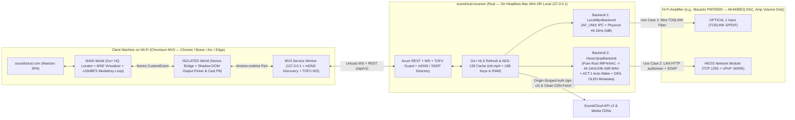

# SoundClud — Project Brief & Technical Architecture Specification (v1.2)

> [!IMPORTANT]
> **Universal Portability Mandate (Zero Per-Track / Per-Device / Per-User / Per-Machine Patches)**:
> Every subsystem in `SoundClud` is designed from first principles to work out-of-the-box on a fresh installation for **any user**, with **any SoundCloud account** (unauthenticated, Free, or Go+ `256 kbps` HQ), over **Wi-Fi or Ethernet LANs**, across macOS (Intel macOS 12 Monterey+ and Apple Silicon) and Linux receivers, **any Denon/Marantz HEOS Built-in amplifier or speaker**, and any **Chromium** desktop browser (`Chrome`, `Brave`, `Arc`, `Edge`). Zero static IPs, personal paths, numeric audio device indices, hardcoded HEOS device names/PIDs, or track-specific workarounds are permitted.

---

## 1. Dual Core Use Cases & Locked Architectural Decisions (v1.2)

`SoundClud` lets listeners browse, queue, scrub waveforms, and press hardware media keys directly inside the native first-party `https://soundcloud.com` web interface while selecting between **two strictly independent, `0 dB` Bit-Perfect Hi-Fi output modes** directly from the Chromium extension:

1. **Use Case 1 — Headless Direct Digital Output (`LocalMpvBackend`: TOSLINK S/PDIF / CoreAudio / ALSA)**:
   - Offloads all SoundCloud stream fetching, decoding, and digital audio output to a headless machine wired directly to an amplifier—such as a Late 2014 Intel Mac Mini (`Macmini7,1`, macOS 12 Monterey) connected via optical Mini-TOSLINK S/PDIF (`'spdf'`).
   - Locks physical CoreAudio hardware clocking to **`24-bit / 44,100 Hz`** (`--audio-samplerate=44100 --coreaudio-change-physical-format=yes`) at **`0 dB` Unity Gain** (`volume=100`, `ao-volume=100`) with continuous idle optical carrier keepalive (`anullsrc`), achieving `~40–180 ms` play/scrub latency and full compatibility with amplifier "Pure Modes" (where internal amp network circuitry is powered off).
2. **Use Case 2 — Direct Denon/Marantz HEOS Network Output (`HeosUpnpBackend`: e.g., Marantz PM7000N)**:
   - Auto-discovers any Denon/Marantz HEOS Built-in device on the LAN (`urn:schemas-denon-com:device:ACT-Denon:1` / `_heos-audio._tcp` / `TCP 1255`) and exposes it as a 1-click target inside the Chromium extension—working identically whether `soundclud-receiver` runs **24/7 on a headless Mac Mini** or **locally on `127.0.0.1` on the client laptop** (requiring zero second computer and zero `mpv` binary in pure-Rust HEOS mode).
   - Automatically wakes the HEOS amplifier from Network Standby (`ACT:1#SetDevicePowerState("ON")`), switches its input to Network/HEOS, displays live **Track Title, Artist & Elapsed Time** on the amplifier's front OLED via UPnP `DIDL-Lite`, and streams byte-range seekable **`44,100 Hz / 24-bit` `0 dB` uncompressed WAV/LPCM (`audio/wav`)** asynchronously over Ethernet/Wi-Fi (`~350–650 ms` warm start & scrub, clocked by the amplifier's internal master crystal oscillator).
3. **Strict Backend Independence & `0 dB` Amp-Knob / Remote-Only Volume**:
   - **Amp Knob / Remote Only**: Both `LocalMpvBackend` (`TOSLINK`) and `HeosUpnpBackend` (`HEOS Direct`) output strictly **`0 dB` Bit-Perfect digital PCM** and **never** mutate hardware or software volume (`heos://player/set_volume` and `RenderingControl::SetVolume` are never called)—leaving attenuation 100% to the physical amplifier knob or remote.
   - **Zero Cross-Coupling**: Selecting TOSLINK never sends HEOS power or input-switch commands, and selecting HEOS never touches CoreAudio/optical outputs.
4. **Chromium-Only Manifest V3, Wi-Fi Resilience & Always-Default Go+ `256 kbps` HQ**:
   - Targets Chromium Manifest V3 (`minimum_chrome_version: "116"`, zero `"cookies"` permission).
   - Piggybacks seamlessly on the user's native `soundcloud.com` login in RAM (`chrome.storage.session` + `RedactedSecret` on receiver) to automatically select **Go+ `aac_256k` (`quality: "hq"`, 256 kbps AAC-LC @ 44.1 kHz)** even when SoundCloud Web defaulted to `sq`.

---

## 2. First-Principles Rejection of Naive Approaches

| Flawed Naive Assumption | Why It Fails in Reality | SoundClud First-Principles Architecture |
| :--- | :--- | :--- |
| **1. Backend `yt-dlp` stream extraction** | Spawns Python + scrapes SoundCloud JS bundles (`1,500–3,500 ms` cold start per click), fails on Go+ / private tracks without fragile cookie exports, and breaks whenever SoundCloud rotates `client_id`. | **Browser Stream-Locator Handoff**: The authenticated browser tab forwards `api-v2` `media.transcodings[]`, `track_authorization`, and ephemeral `OAuth` session context in `<5 ms` with zero Python/`yt-dlp` dependency. |
| **2. Passing raw SoundCloud `.m3u8` URLs directly to `mpv` or HEOS UPnP** | SoundCloud VOD `.m3u8` URLs (`#EXT-X-MAP` `init.mp4`, `#EXT-X-KEY`, `.m4s`) expire after **~15–30 minutes** (`HTTP 403` mid-DJ-mix). Furthermore, Denon/Marantz AIOS (`GetProtocolInfo`) supports **zero** HLS (`.m3u8`), fMP4 (`#EXT-X-MAP`), `AES-128`, or Opus MIME types. | **Embedded HLS Refresh Proxy + Pure-Rust `44.1 kHz / 24-bit` WAV Streamer**: Refreshes expiring CloudFront signatures transparently, feeding rewritten HLS to local `mpv` (`TOSLINK`) or continuous `44.1 kHz / 24-bit` `0 dB` `audio/wav` over HTTP to HEOS (`AVTransport`). |
| **3. Pure Browser Extension -> HEOS Direct or HEOS Built-In SoundCloud (`sid = 9`)** | Chromium MV3 has no raw TCP (`1255`) or UDP multicast (`1900` SSDP) sockets. Meanwhile, HEOS CLI's built-in `sid = 9` **has no `seek`/scrub command**, cannot play arbitrary `soundcloud.com` or `?secret_token=` URLs, requires static HEOS-app login, and cannot guarantee Go+ `aac_256k` HQ. | **Unified `soundclud-receiver` Multi-Output Gateway** (on LAN server or `127.0.0.1`): Discovers HEOS via SSDP/mDNS/`TCP 1255`, wakes via `ACT:1`, and drives `:60006` `AVTransport` with full `REL_TIME` waveform scrubbing and `DIDL-Lite` OLED metadata. |
| **4. Streaming compressed `256 kbps` AAC over HTTP to HEOS `AVTransport`** | Denon/Marantz AIOS pre-buffers ~`128 KB` before unmuting the DAC; at `256 kbps` (`32 KB/s`), every play or scrub lags by **`~4.0 seconds`**. | **Uncompressed `44,100 Hz / 24-bit` `0 dB` WAV (`264.6 KB/s`)**: Fills AIOS's `128 KB` buffer in **`~0.48 seconds` (`~350–650 ms` warm play/scrub)** with deterministic `O(1)` byte-offset seeking (`44 + frame * 6`). |
| **5. Homebrew setup + `48 kHz` CoreAudio default + TOSLINK idle sleep** | Late 2014 Mac Minis max out at **macOS 12 Monterey** (dropped by Homebrew 4.4+). Without `--coreaudio-change-physical-format=yes` at `44.1 kHz`, `coreaudiod` resamples `44.1 -> 48 kHz`; idle TOSLINK powers off its laser after ~7–30s, causing loud DAC pops. | **Zero-Homebrew Static Rust Daemon (`MACOSX_DEPLOYMENT_TARGET=11.0`) + Physical `44.1 kHz` `0 dB` Clock + Idle `anullsrc` Optical Carrier Keepalive**. |

---

## 3. End-to-End System Architecture

---

## 4. Detailed Subsystem Specifications

### 4.1 Zero-Friction SoundCloud Go+ Authentication & Stream Selection
1. **Why SoundCloud Web Defaults to `sq` — And How SoundClud Guarantees Go+ `hq` (`aac_256k`)**:
   - SoundCloud Web stores streaming preferences in `localStorage["V2::local::settings"]` with `streamingQuality: null` -> `"sq"` by default, discarding `"hq"` client-side even though **`api-v2.soundcloud.com` always includes `quality: "hq"` (`aac_256k`) in `media.transcodings[]`** for authenticated Go+ sessions.
   - SoundClud's `MAIN`-world Stream-Locator ranks `media.transcodings[]` directly (`aac_256k` Go+ HQ > `aac_160k` SQ > `mp3_1_0` 128k > `aac_96k` LQ > `opus_0_0` 64k), skips broken `abr_*` `404` stubs, only reuses Maestro's in-tab `.m3u8` if it matches our #1 ranked transcoding, and promotes unset `V2::local::settings.streamingQuality` to `"hq"` when `"hq_audio"` is present.
2. **100% Seamless Session Piggybacking (Zero Separate Login & Zero `"cookies"` Permission)**:
   - Passively observes `window.__sc_hydration` (`apiClient.id`, `features`, `meUser`) and `Authorization: OAuth <token>` / `document.cookie` `oauth_token` (including mid-session logins and expiring JWT refreshes).
   - Holds auth strictly in `chrome.storage.session` (Chromium RAM) and `RedactedSecret` session RAM on `soundclud-receiver` (zeroed on `stop`/disconnect; never logged or persisted to disk).
3. **Playable `encrypted-hls` (`AES-128`) vs Mixed-Queue Widevine Fallback (`drm_local_fallback`)**:
   - Accepts `format.protocol` in `["hls", "encrypted-hls", "progressive"]` (`hls` > `encrypted-hls` > `progressive`), rejecting hardware-CDM-only `"ctr-encrypted-hls"` / `"cbc-encrypted-hls"`.
   - When a major-label track offers *only* Widevine/FairPlay CENC full streams, SoundClud marks that track `drm_local_fallback` (`Widevine DRM • Playing Locally`) so it plays full-length in Chromium rather than a 30s preview, then **automatically resumes TOSLINK or HEOS handoff on the next non-DRM track**.

### 4.2 Shared HLS Refresh & AES-128 Session Cache (`crates/receiver`)
- Caches `#EXT-X-MAP` (`init.mp4`) and `#EXT-X-KEY` (`METHOD=AES-128` 16-byte key) in session RAM so arbitrary seeks 45+ minutes into a DJ mix never `HTTP 403`.
- Proactively refreshes upstream `.m3u8` segment URLs via `transcoding.url` (or WS `refresh_locator_request`) before CloudFront TTL expiry or on `401`/`403`.
- **Strict Origin-Scoped Auth**: Sends `client_id`, `track_authorization`, `secret_token`, and `Authorization: OAuth <token>` **strictly** to `api-v2.soundcloud.com` / `api.soundcloud.com`—never to signed CDN hosts (`playback.media-streaming.soundcloud.cloud`, `*.sndcdn.com`).

### 4.3 Dual Independent Audio Backends (`AudioBackend` Trait)

#### Backend 1 — `LocalMpvBackend` (CoreAudio / TOSLINK S/PDIF / PipeWire / ALSA)
- Binds persistent device UID (`--audio-device=coreaudio/<UID>`, auto-detecting `'spdf'` optical Digital Out on macOS) via `AF_UNIX` JSON IPC:
  `--ao=coreaudio --audio-samplerate=44100 --coreaudio-change-physical-format=yes --volume=100 --idle=yes --keep-open=yes --audio-stream-silence=yes --gapless-audio=yes --cache=yes --demuxer-max-bytes=32MiB --cache-pause-initial=no`.
- Streams `av://lavfi:anullsrc=r=44100:cl=stereo` while idle (plus optional idle-only `-120 dBFS` `anoisesrc`) and holds `caffeinate -s` to prevent macOS optical laser sleep pops.
- Never issues HEOS network calls when selected.

#### Backend 2 — `HeosUpnpBackend` (Universal Denon/Marantz HEOS Direct Network)
- **Zero-Config Discovery**: Discovers all HEOS Built-in amps/speakers on the LAN via SSDP `M-SEARCH` (`urn:schemas-denon-com:device:ACT-Denon:1` / `AiosDevice:1`), Bonjour (`_heos-audio._tcp`), and HEOS CLI (`TCP 1255` `heos://player/get_players`). Identifies devices via salted SHA-256 opaque IDs (`heos_<16-hex>`) derived from UDN/serial—never persisting raw serials, MACs, or HEOS `service_username`s.
- **Hands-Free Standby Auto-Wake & OLED Metadata**:
  - Queries `ACT:1#GetDevicePowerState` (`:60006/ACT/control`); if `"OFF"`, invokes `ACT:1#SetDevicePowerState("ON")` and awaits transport readiness before issuing `AVTransport::SetAVTransportURI` (embedding clean `DIDL-Lite` Track Title, Artist, and Artwork XML so the amplifier's front OLED displays live track details) + `Play`.
- **Pure-Rust `44,100 Hz / 24-bit` `0 dB` WAV HTTP Streamer**:
  - Unwraps fMP4 (`init.mp4` + `.m4s` `moof`/`mdat`), decrypts `AES-128` segments if present, and decodes AAC-LC / MP3 in safe Rust (`symphonia`, with `mpv` PCM fallback if present for rare legacy `opus_0_0`) into continuous **`44,100 Hz / 24-bit` `0 dB` stereo WAV (`audio/wav`)** served at `http://<receiver_lan_ip>:<ephemeral_port>/heos/<capability_token>/stream.wav`.
  - Supports HTTP `Range: bytes=...` + `?start_ms=` stream re-anchoring so `AVTransport::Seek(REL_TIME)` scrubs deterministically across multi-hour mixes in `~400–750 ms`.
- **Strict Amp-Volume Invariant**: Outputs `0 dB` unity-gain PCM samples and **never** calls `heos://player/set_volume` or `RenderingControl::SetVolume`. Never touches local CoreAudio outputs when selected.

### 4.4 Clean Maestro MSE Virtualization, Multi-Output Picker & Wi-Fi Resilience
- **Unified Output Picker (Popup `<dialog>` + Player Bar Shadow DOM Cast Pill)**:
  - Probes `http://127.0.0.1:9876/api/v1/discover`, `http://soundclud.local:9876/api/v1/discover`, and cached unicast LAN endpoints (`Promise.any`) with zero-click **TOFU** bearer token security + strict `Host`/`Origin` checks.
  - Lists all discovered **CoreAudio/TOSLINK** and **HEOS Direct** outputs (`e.g., Optical Out • 44.1kHz 0dB` and `Marantz PM7000N • HEOS 44.1kHz 0dB`), adapting scrub drag debounce automatically per backend (`60 ms` for TOSLINK; `180 ms` for HEOS UPnP) and displaying `Waking Amplifier...` during cold HEOS relay wake.
  - Loops a 10s `-100 dBFS` in-memory WAV (`muted = false`, `volume = 0.01`) so Chromium routes MacBook hardware Play/Pause/Next/Prev keys (`navigator.mediaSession`).

---

## 5. Wire Protocol Summary (`v1`, Default Port `9876`)

- **`GET /api/v1/discover`** — Receiver identity, capabilities, peer-discovered LAN receivers, and discovered `OutputDevice[]` targets (`kind: "coreaudio" | "alsa" | "heos_upnp"`, `id`, `name`, `model`, `transport`, `capabilities: { autoWake, seekDebounceMs }`).
- **`GET /api/v1/audio/devices` & `POST /api/v1/config`** — Inspect and select the active `OutputDevice` (`id`) and optical idle keepalive options (volume mode is locked to `bit_perfect` `0 dB`).
- **`GET /api/v1/status` & `ws://<host>:9876/api/v1/ws`** — Full-duplex commands (`hello`, `load_track`, `set_paused`, `seek`, `preload_next`, `stop`, `select_output`, `refresh_locator_response`, `ping`) and events (`welcome`, `state_tick` including `waking_device` state + Go+ tier/codec telemetry, `track_ended`, `outputs_updated`, `refresh_locator_request`, `session_claimed`, `pong`).
- **`GET /hls/:session_id/*` (`127.0.0.1` only)** & **`GET /heos/:capability_token/stream.wav` (LAN capability-guarded)** — Internal media feeds for `LocalMpvBackend` and `HeosUpnpBackend`.

---

## 6. Phased Implementation Plan & Quantitative Acceptance Gates

| Phase | Scope & Specialist Owner(s) | Quantitative Acceptance Gate |
| :--- | :--- | :--- |
| **Phase 0 (Complete)** | Workspace foundation, 6 specialist subagents, 4 workflow skills, `OfflineNetworkGuard`, Zero-PII gates, GitHub SSH repo (`Space-Cadet0/SoundClud`). | `npm run verify` 100% green; `0` PII/secret leaks; clean `x86_64` Monterey + `aarch64` Rust checks. |
| **Phase 1 — Shared Wire Protocol (`v1`)** | `protocol-contracts-architect` (`packages/protocol` + Rust `protocol` module): Unified `OutputDevice` (`coreaudio`/`alsa`/`heos_upnp`), Go+ locator, TOFU auth, `waking_device`, `drm_local_fallback`, `0 dB` `44.1 kHz` contracts. | 100% TypeScript <-> Rust serde roundtrip parity; `0` `any` types. |
| **Phase 2 — Rust Receiver (`TOSLINK` + `HEOS`)** | `receiver-daemon-architect` (`crates/receiver`): HLS/AES-128 RAM cache + `LocalMpvBackend` (`44.1 kHz` physical `0 dB` TOSLINK) + `HeosUpnpBackend` (SSDP/mDNS/`TCP 1255`, `ACT:1` auto-wake, `DIDL` OLED, pure-Rust `44.1 kHz/24b` WAV streamer). | TOSLINK `< 180 ms` & HEOS `< 650 ms` warm start/scrub against offline mock `mpv` + mock HEOS `:1255`/`:60006` servers; `0` `set_volume` calls; `0` `403` mid-mix drops. |
| **Phase 3 — Chromium MV3 Extension** | `extension-maestro-engineer` (`packages/extension`): 3-world Chromium MV3, zero-login Go+ `aac_256k` ranker, MSE virtualizer, Widevine local fallback, `-100 dBFS` media-key loop, unified TOSLINK/HEOS Output Picker & Cast Pill. | Always picks `aac_256k` `hq` over `sq`; dynamic `60ms`/`180ms` scrub debounce; `0` local decode CPU during handoff; zero `"cookies"` permission. |
| **Phase 4 — Zero-Homebrew Packaging & Adversarial QA** | `packaging-service-ci-engineer` + `adversarial-qa-hygiene-verifier`: Monterey+ (`x86_64`/`aarch64`) & Linux `install.sh`, `launchd`/`systemd` units, `CHROMEWEBSTORE.md`, release CI, full offline chaos & Zero-PII verification. | Fresh install `< 15 s` without Homebrew; `100%` offline test suite `< 5 s`; `SHA256SUMS.txt` verified artifacts. |
